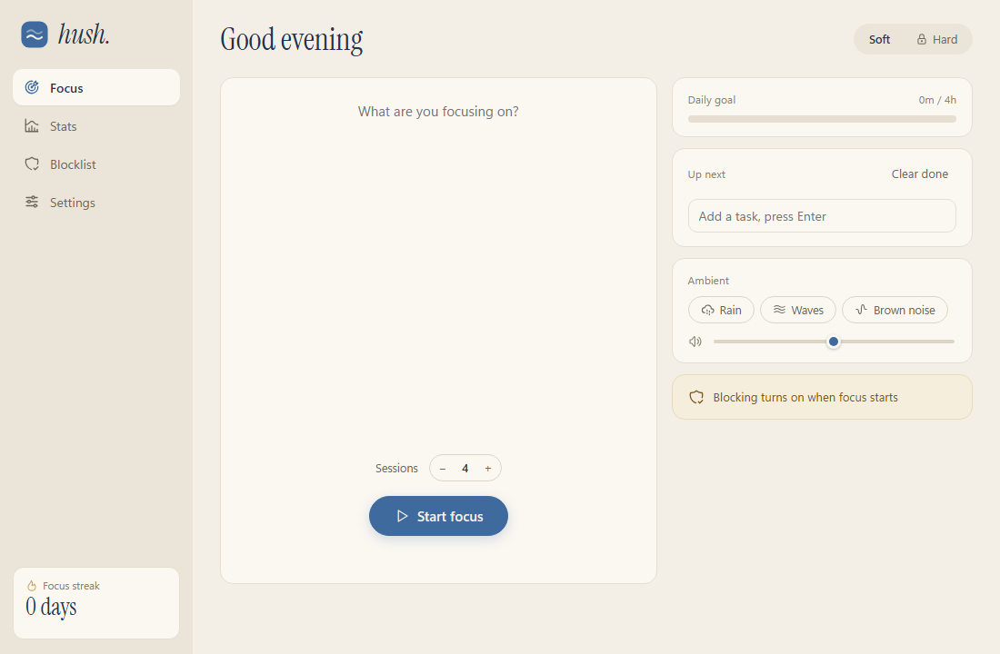

# hush. - a calm focus timer for Windows

**Focus timer, app and website blocker, and screen-time tracker in one quiet app.** The timer is a tide: the water drains as focus time passes and refills during breaks.

## Features
- **Tide timer** with Soft mode (pause allowed, but stopping early costs a typed sentence or a 60s wait) and Hard mode (no pause, no stop)
- **App blocking:** auto-detects Steam, Epic, Riot and Xbox games and launchers, with a 10 second warning to save
- **Site blocking** through a browser extension (Chrome, Edge, Brave), including a YouTube Shorts-only block
- **Screen-time stats** per app and per site
- **Android companion app** that sends distracting apps back to the home screen while your laptop is in focus
- Ambient rain, waves and brown noise, soft sound effects, daily goal, task list, focus streak and keyboard shortcuts

## Install
1. Install Python 3.10+ from python.org and tick **Add python.exe to PATH**.
2. Download the latest zip from [Releases](https://github.com/VishwakVemuru/hush/releases), or clone the repo.
3. Open the `hush` folder and double-click **`hush.bat`**. The first run installs its dependencies, then hush. opens.

Full setup, including the browser extension, system-wide site blocking and the Android app, is in [hush/README.md](hush/README.md).

## Built with
Python, pywebview, psutil and pystray, with a plain HTML, CSS and JavaScript interface. Icons are from Tabler Icons (licence included).

If you find it useful, a star helps others find it.

Built by [Vishwak Vemuru](https://github.com/VishwakVemuru). MIT licence.
